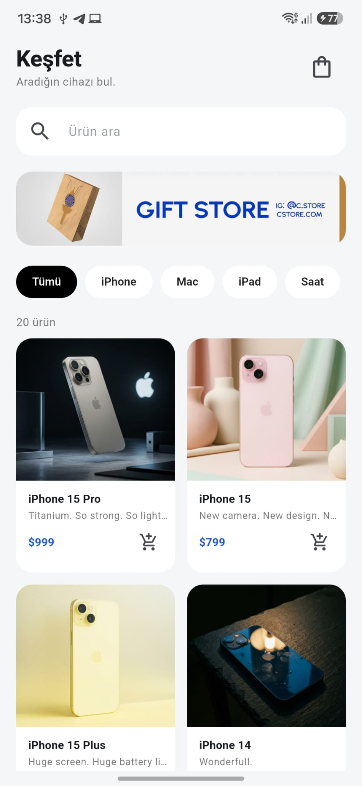
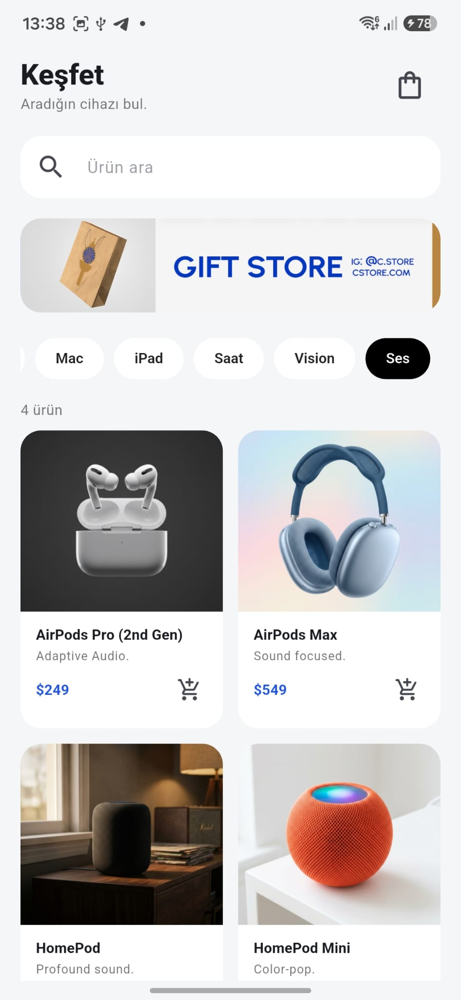
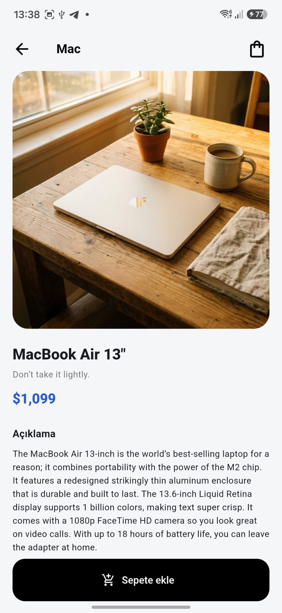
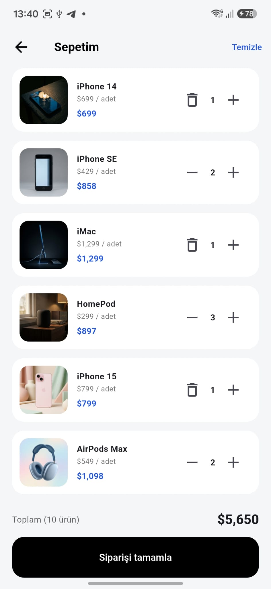
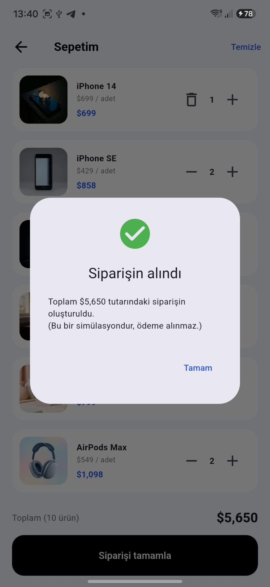
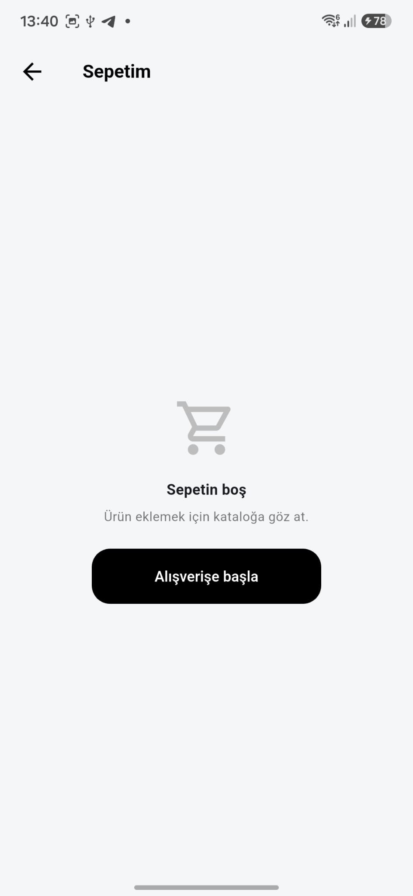

# Mini Katalog

Flutter ile geliştirilmiş basit bir mobil ürün kataloğu uygulaması. Ürünler listelenir, aranır, kategoriye göre filtrelenir; ürün detayına geçilir ve ürünler sepete eklenir (sepet simülasyonu).

Mobil Uygulama Geliştirme (Flutter) eğitimi proje çıktısı olarak hazırlanmıştır.

## Kullanılan sürümler

| Araç | Sürüm |
|---|---|
| Flutter | 3.47.9 (stable) |
| Dart | 3.13.7 |
| Android | minSdk 24, targetSdk 36 |

Yönerge gereği **ekstra paket kullanılmamıştır**; yalnızca Flutter SDK'nın kendisi (`material.dart`) kullanılır.

## Özellikler

- **Ana sayfa:** Banner, ürün arama kutusu ve kategori filtresi (Tümü, iPhone, Mac, iPad, Saat, Vision, Ses).
- **Ürün listesi:** `GridView.builder` ile iki sütunlu ürün kartları.
- **Ürün detayı:** Görsel, açıklama, fiyat ve teknik özellikler. Ürün, detay sayfasına **Route Arguments** ile gönderilir.
- **Sepet (simülasyon):** Sepete ekleme, adet artırma/azaltma, ürün çıkarma, toplam tutar ve sipariş onayı. Bir üründen en fazla 10 adet eklenebilir.
- **Sayfa geçişleri:** İsimli rotalar (Named Routes) ve `Navigator.pushNamed` / `pop`.

## Ekran görüntüleri

Samsung Galaxy S24 üzerinde çalışırken alınmıştır ([`screenshots/`](screenshots/) klasörü).

| Ana sayfa | Kategori filtresi | Ürün detayı |
|---|---|---|
|  |  |  |

| Sepet | Sipariş onayı | Boş sepet |
|---|---|---|
|  |  |  |

## Kurulum ve çalıştırma

Gerekenler: Flutter SDK, Android SDK ve USB hata ayıklaması açık bir Android telefon ya da Android Emulator.

```bash
git clone <repo-adresi>
cd mobil
flutter pub get
flutter devices      # telefonun/emülatörün listelendiğini kontrol et
flutter run
```

Diğer komutlar:

```bash
flutter test         # birim ve widget testleri
dart analyze         # kod analizi (proje yolunda Türkçe karakter varsa `flutter analyze` yerine bunu kullanın)
flutter build apk    # Android kurulum dosyası (build/app/outputs/flutter-apk/)
```

## Proje yapısı

```
lib/
├── main.dart                     Uygulamanın giriş noktası
├── app.dart                      MaterialApp, tema ve isimli rotalar
├── routes.dart                   Rota adları
├── theme.dart                    Uygulama teması
├── models/product.dart           Ürün modeli (fromJson / toJson)
├── data/product_repository.dart  JSON dosyasından ürünleri okuma
├── state/
│   ├── cart_controller.dart      Sepet durumu (ChangeNotifier)
│   └── cart_scope.dart           Sepeti widget ağacına taşıyan InheritedNotifier
├── screens/
│   ├── home_screen.dart          Ana sayfa ve ürün listesi
│   ├── product_detail_screen.dart Ürün detayı
│   └── cart_screen.dart          Sepet
├── widgets/                      Ürün kartı, sepet butonu, boş durum vb.
└── utils/                        Fiyat biçimlendirme, özellik etiketleri
assets/
├── data/products.json            Ürün verisi (JSON simülasyonu)
└── images/                       Ürün görselleri ve banner
test/                             Model, sepet ve ekran testleri
```

## Veri kaynağı

Ürün verileri ve görseller, eğitim yönergesinde verilen demo kaynaktan alınmıştır:

- Ürünler: https://wantapi.com/products.php
- Banner: https://wantapi.com/assets/banner.png

Veriler internet bağlantısı gerektirmemesi için uygulamanın içine (`assets/`) eklenmiştir. Kategori filtresi için her ürüne bir `category` alanı eklenmiş, görsel adresleri uygulama içindeki dosyaları gösterecek şekilde güncellenmiştir. Bu veriler yalnızca eğitim ve demo amaçlıdır; ürün adları ve markalar sahiplerine aittir.
